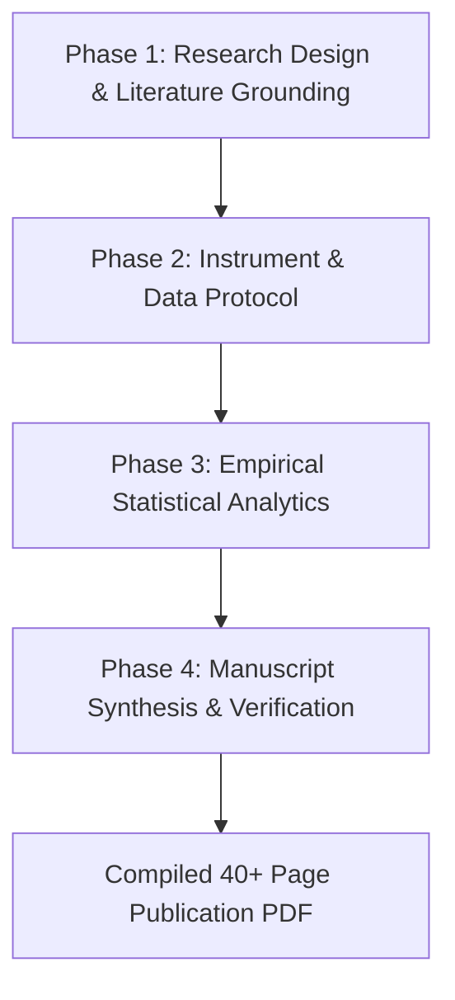

# Academic Research & Empirical Manuscript Pipeline

## Overview

The `academic-research-pipeline` skill transforms AI from a generic text generator into a scientifically rigorous, defensible **Research Co-Pilot**. It guides researchers, academics, and graduate students through the complete research lifecycle—from epistemological problem formulation and survey instrument design to automated statistical analytics, publication-grade visualization, and comprehensive manuscript preparation in LaTeX or Typst.

Most importantly, it enforces a strict **Anti-Ghostwriting Protocol**: the AI never invents empirical statistics, fake literature, or speculative $p$-values. Every quantitative claim is verified programmatically against raw data files.

---

## Dependencies

This skill integrates seamlessly with installed scholarly skills:
- **`literature-search-openalex` / `literature-search-europepmc` / `literature-search-arxiv` / `pubmed-database`**: Use to look up real bibliographic metadata, verify author papers, and generate authentic BibTeX entries without hallucinations.
- **`credentials`**: Use when credentials (e.g. email app passwords for survey distribution) are required.

---

## Quick Start

### 1. Run Complete Empirical Analytics
Given any dataset (e.g., `Data sheets/dummy_data.csv`), execute the analytics engine to generate ground-truth statistics, tables, and 300 DPI graphics:
```bash
uv run --with pandas --with scipy --with matplotlib --with seaborn \
  ~/.gemini/config/skills/academic-research-pipeline/scripts/run_statistical_analytics.py all \
  --dataset "Data sheets/dummy_data.csv" \
  --output-dir "Data Analysis" \
  --group-col "Role" \
  --dpi 300
```

### 2. Scaffold Academic Monograph
Generate the publication scaffold linking all empirical data:
```bash
uv run ~/.gemini/config/skills/academic-research-pipeline/scripts/generate_manuscript_scaffold.py \
  --title "Quantitative Evaluation of Technical Trading Models" \
  --author "Lead Researcher" \
  --summary-json "Data Analysis/dataset_summary.json" \
  --output-dir "Manuscript_Package"
```

### 3. Verify Academic Integrity (Anti-Ghostwriting Audit)
Before compilation, audit the text against the dataset and BibTeX records:
```bash
uv run ~/.gemini/config/skills/academic-research-pipeline/scripts/verify_academic_integrity.py \
  --manuscript "Manuscript_Package/main.tex" \
  --bib "Manuscript_Package/references.bib" \
  --summary-json "Data Analysis/dataset_summary.json" \
  --output-report "Manuscript_Package/Manuscript_Quality_Check.md"
```

---

## Utility Scripts

All utility scripts are self-contained and located in `scripts/`:

### 1. `run_statistical_analytics.py`
Executes data analysis directly from CSV:
- `all`: Executes descriptive stats, frequency cross-tabs, Spearman correlation matrix, inferential tests (Kruskal-Wallis/ANOVA), and generates 300 DPI figures.
- `describe`: Generates `dataset_summary.json` containing verified means, standard deviations, medians, skewness, kurtosis, and frequency counts.
- `correlate`: Computes Spearman's rank / Pearson correlation matrix with heatmaps.

### 2. `generate_manuscript_scaffold.py`
Builds publication-ready LaTeX or Typst monograph structures with formal IMRaD sections, automated cross-references, and starter bibliography.

### 3. `verify_academic_integrity.py`
The anti-ghostwriting validator:
- Verifies sample size ($N$) and numerical claims match `dataset_summary.json`.
- Validates in-text citations against `references.bib` (0 broken citations).
- Scans for and reports any unaddressed `[Author verification required]` tags.

---

## The 4-Phase Research Workflow



### Phase 1: Research Design & Literature Grounding
- Formulate Research Questions ($RQ_1-RQ_4$) and testable hypotheses ($H_1-H_4$).
- Use academic database search tools (`literature-search-openalex`, `pubmed-database`, `arxiv`) to identify authentic peer-reviewed papers.
- Build `references.bib` with verified DOIs, author names, and publication venues.

### Phase 2: Instrument & Data Protocol
- Operationalize survey items or experimental variables using `references/google_forms_script_template.js`.
- Ingest real empirical data or simulate verified response distributions into `Data sheets/`.

### Phase 3: Empirical Statistical Analytics
- Run `run_statistical_analytics.py` to produce zero-hallucination statistical tables and high-resolution plots.
- Follow the decision rules in `references/statistical_analysis_standards.md` (e.g. non-parametric tests like Kruskal-Wallis for skewed/ordinal survey scales).

### Phase 4: Manuscript Synthesis & Integrity Verification
- Write complete, publication-grade academic chapters (Introduction, Literature Review, Methodology, Results, Discussion, Limitations, Conclusion, and Appendices).
- Adhere strictly to `references/anti_ghostwriting_protocol.md`.
- Run `verify_academic_integrity.py` and output `Manuscript_Quality_Check.md`.
- Compile using `pdflatex` or `tectonic`.

---

## Anti-Ghostwriting & Academic Integrity Rules

1. **Never Invent Data:** If a statistical test was not executed on the raw dataset, it cannot appear in the manuscript.
2. **Never Fabricate References:** Every citation must be a real, indexed scholarly publication.
3. **Explicit Author Verification:** Any missing detail (e.g. institutional ethics board approval, specific pilot dates) must be tagged with `[Author verification required]` rather than filled with AI assumptions.
4. **Transparent Negative Results:** If statistical tests fail to reject the null ($p > .05$), report them faithfully and discuss theoretical implications honestly.

---

## Common Mistakes

- **Mistake 1:** Guessing percentages in the manuscript text instead of querying `dataset_summary.json`.  
  *Fix:* Always run `run_statistical_analytics.py` first and copy exact numbers from the generated JSON/CSV tables.
- **Mistake 2:** Creating fictitious BibTeX citation keys.  
  *Fix:* Use `literature-search-openalex` or verified paper sources to populate `references.bib`.
- **Mistake 3:** Treating AI as a standalone ghostwriter.  
  *Fix:* Treat AI as a co-pilot; prompt it to audit, calculate, and format, while ensuring the human researcher reviews and endorses all theoretical conclusions.
